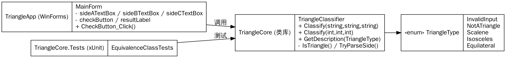
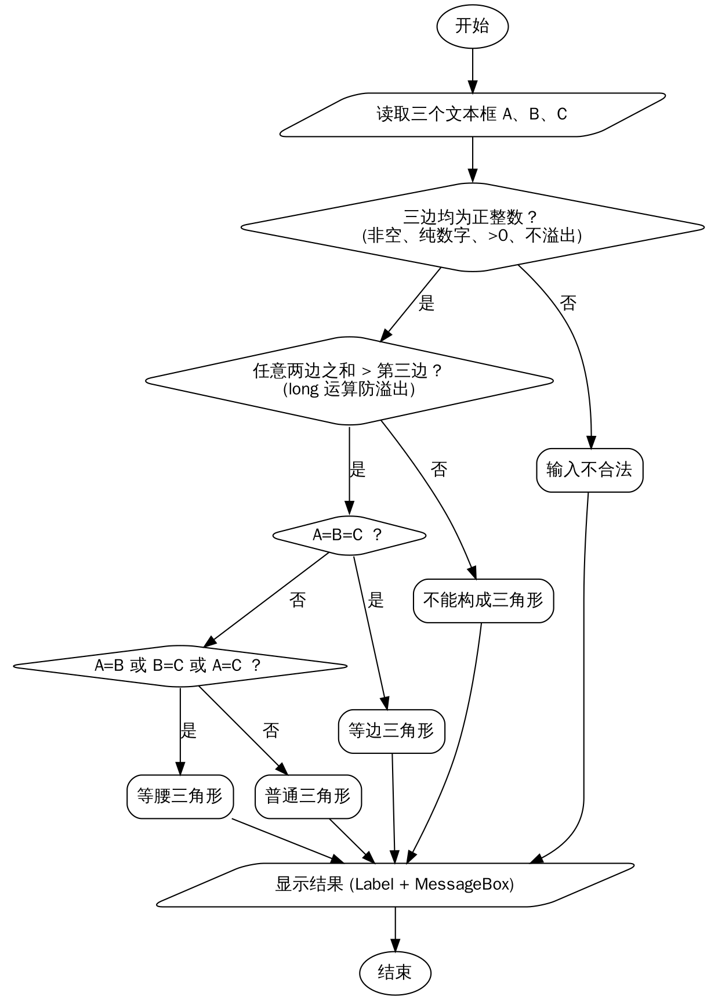

# 实验一　高质量编程　实验报告

| 课程名称 | 软件质量保证与测试（1960673） | 实验名称 | 高质量编程 |
|---|---|---|---|
| 学　　号 | ________ | 姓　　名 | ________ |
| 专业班级 | 软件工程 ____ 班 | 实验地点 | 华信软件学院 B514 机房 |
| 实验日期 | 2026.11.9（第11周）、2026.11.16（第12周） | 指导教师 | ________ |
| 成　　绩 | | | |

## 一、实验说明

### 1. 实验目的
1. 理解什么是高质量编程，认识统一编码规范在软件开发过程中的必要性；
2. 掌握命名规则、书写格式、表达式、异常与内存管理等提高代码质量的具体规范；
3. 体会高质量编程对提升软件质量（正确性、健壮性、可读性、可维护性、可测试性）的作用。

### 2. 实验内容
编写程序：读入 3 个正整数，作为三角形三条边的长度，输出该三角形是**普通的、等腰的还是等边的**。要求：
- a) 用 C# 编写可视化图形界面（WinForms）；
- b) 按《C# 代码编写指南》完成高质量代码书写。

### 3. 实验环境
Windows 10/11，Visual Studio 2022，.NET 8（WinForms），xUnit 单元测试框架。

### 4. 实验步骤
1. 新建 C# WinForms 项目 `TriangleApp`，另建类库 `TriangleCore` 存放业务逻辑；
2. 设计窗体：3 个 `TextBox` 输入三边，`check` 按钮触发判定，`Label` + `MessageBox` 输出结果；
3. 编码实现判定功能，过程中运用命名、格式、表达式、内存管理等规范；
4. 运行程序，记录各类输入的结果并附于报告。

## 二、实验分析

### 1. 需求分析
| 输入情况 | 程序应给出的输出 |
|---|---|
| 三边均为正整数，且两边之和大于第三边，三边全等 | 等边三角形 |
| 同上，恰有两边相等 | 等腰三角形 |
| 同上，三边互不相等 | 普通三角形 |
| 三边为正整数，但某两边之和 ≤ 第三边 | 不能构成三角形 |
| 有边为空、非数字、小数、负数、0、超出整数范围 | 输入不合法 |

需要特别注意：
- **等边三角形也满足“两边相等”**，所以必须先判等边、再判等腰，保证结果互斥；
- 三边都接近 `int.MaxValue` 时，`a + b` 会发生 **int 溢出**变成负数，导致误判，求和要用 `long`；
- 输入来自文本框，必须考虑**空串、非法字符、超大数**，不能让程序抛出未处理异常。

### 2. 对指导书附件代码的质量分析
逐行审查附件代码，按《C# 代码编写指南》的各条规范，发现下列问题：

| # | 规范类别 | 附件代码中的问题 | 后果 | 改进做法 |
|---|---|---|---|---|
| 1 | 命名规则 | `button1`、`textBox1~3`、`Check1/2/3`、`t1`、`e1`、`Numbers`（局部变量用了大写开头）；命名空间 `BlacakCheckTriangle` 拼写错误 | 看名字不知道含义，可读性差 | 控件 `sideATextBox`、`checkButton`；方法 `Classify`、`IsTriangle`、`TryParseSide`；类型/方法 PascalCase，局部变量 camelCase |
| 2 | 异常处理 | 正则 `^[0-9]*$` 中 `*` 允许空串，随后 `Int32.Parse("")` 抛 `FormatException` | **输入为空时程序崩溃** | 使用 `string.IsNullOrWhiteSpace` + `int.TryParse`，不抛异常 |
| 3 | 异常处理 | 超长数字（如 `99999999999`）能通过正则，`Int32.Parse` 抛 `OverflowException` | **程序崩溃** | `TryParse` 失败即判为输入不合法 |
| 4 | 功能正确性 | 等边三角形输出“等腰等边三角形”；普通三角形只输出“三角形” | 与题目要求不符 | 用枚举 `TriangleType` 表示互斥的 5 种结果 |
| 5 | 内存管理 | `Dictionary` 只用来存两个 0/1 标志；`powSum`、`max`、`Numbers` 计算后从未使用；每次点击都 `new Regex` | 浪费内存与 CPU，干扰阅读 | 删除无用变量和对象；不再使用正则 |
| 6 | 表达式 | 先按 `int` 校验又按 `double` 解析，类型前后不一致；`cond ? true : false` | 表达式冗余、意图不清 | 统一用 `int`；直接 `return` 布尔表达式 |
| 7 | 书写格式 | `Check1` 用循环加计数器 `succFlag` 判断三边关系，再用 `if…return true else return false` | 代码冗长 | 一行表达式 `a + b > c && a + c > b && b + c > a` |
| 8 | 程序结构 | 所有逻辑都写在按钮事件中 | 无法单元测试、无法复用 | 界面与逻辑分离（见下文结构图） |
| 9 | 注释 | 没有方法注释 | 难以维护 | 公共成员写 XML 文档注释 |
| 10 | 无用引用 | 引用了 `System.Data`、`System.Threading.Tasks` 等未使用的命名空间 | 代码冗余 | 只保留必要的 `using` |

> 实验二中用同一组测试用例对附件原代码进行了验证，上述第 2、3、4 条缺陷已被自动化测试**复现**（见实验二报告“原代码缺陷验证”）。

### 3. 设计思路

**（1）程序结构：界面与业务逻辑分离**



- `TriangleCore`：纯逻辑类库，不依赖任何界面，可被单元测试直接调用；
- `TriangleApp`：窗体只负责“取输入 → 调用 `Classify` → 显示结果”。

**（2）判定流程**



### 4. 编码规范的落实

| 规范 | 本实验中的具体做法 |
|---|---|
| 命名规则 | 类、方法、枚举、属性使用 PascalCase（`TriangleClassifier`、`GetDescription`）；参数、局部变量使用 camelCase（`sideA`、`sideAText`）；控件“含义+控件类型”（`sideATextBox`、`checkButton`）；布尔方法用 `Is/Try` 开头 |
| 书写格式 | 4 空格缩进；大括号独占一行；`if` 即使只有一句也加大括号；一行只写一条语句；长参数列表换行对齐 |
| 表达式 | 条件判定直接返回布尔表达式；用 `long` 做加法避免溢出；用 `switch` 把枚举映射为提示文本，`default` 分支抛出异常防止遗漏 |
| 异常与输入处理 | 使用 `TryParse` 代替 `Parse`，不依靠异常控制流程；`NumberStyles.None` 拒绝正负号、小数点 |
| 内存管理 | 不创建无用的集合和 `Regex` 对象；窗体 `Dispose` 中释放 `components`；静态工具类无实例开销 |
| 编译检查 | 项目开启 `Nullable`（可空引用检查）与 `TreatWarningsAsErrors`（警告视为错误），由编译器强制保证规范 |

### 5. 核心代码

```csharp
public static TriangleType Classify(int sideA, int sideB, int sideC)
{
    if (sideA <= 0 || sideB <= 0 || sideC <= 0)
    {
        return TriangleType.InvalidInput;
    }

    if (!IsTriangle(sideA, sideB, sideC))
    {
        return TriangleType.NotATriangle;
    }

    if (sideA == sideB && sideB == sideC)
    {
        return TriangleType.Equilateral;
    }

    if (sideA == sideB || sideB == sideC || sideA == sideC)
    {
        return TriangleType.Isosceles;
    }

    return TriangleType.Scalene;
}

private static bool IsTriangle(int sideA, int sideB, int sideC)
{
    long a = sideA;   // 使用 long，避免 int.MaxValue 相加溢出
    long b = sideB;
    long c = sideC;
    return a + b > c && a + c > b && b + c > a;
}

private static bool TryParseSide(string? text, out int side)
{
    side = 0;
    if (string.IsNullOrWhiteSpace(text))
    {
        return false;
    }

    bool parsed = int.TryParse(text.Trim(), NumberStyles.None,
                               CultureInfo.InvariantCulture, out side);
    return parsed && side > 0;
}
```

窗体事件处理只有三步：

```csharp
private void CheckButton_Click(object? sender, EventArgs e)
{
    TriangleType type = TriangleClassifier.Classify(
        sideATextBox.Text, sideBTextBox.Text, sideCTextBox.Text);
    string message = TriangleClassifier.GetDescription(type);
    resultLabel.Text = message;
    MessageBox.Show(message, "判定结果", MessageBoxButtons.OK, MessageBoxIcon.Information);
}
```

完整源代码见 `src/TriangleCore/` 与 `src/TriangleApp/`。

## 三、程序运行结果

### 1. 界面
窗体标题“三角形形状判定”，包含边 A/B/C 三个输入框、`check` 按钮（回车也可触发）和结果标签，窗体固定大小、居中显示。

> 【截图 1：程序主界面】（在 Windows 下运行 TriangleApp 后截图粘贴于此）

### 2. 运行结果

| 序号 | 输入 (A, B, C) | 输出结果 | 是否正确 | 截图 |
|---|---|---|---|---|
| 1 | 3, 4, 5 | 普通三角形 | 正确 | 截图 2 |
| 2 | 3, 3, 4 | 等腰三角形 | 正确 | 截图 3 |
| 3 | 5, 5, 5 | 等边三角形 | 正确 | 截图 4 |
| 4 | 1, 2, 3 | 不能构成三角形！ | 正确 | 截图 5 |
| 5 | （空）, 4, 5 | 输入不合法，请输入三个正整数！ | 正确（原代码此处崩溃） | 截图 6 |
| 6 | a, 4, 5 | 输入不合法，请输入三个正整数！ | 正确 | 截图 7 |
| 7 | 99999999999, 4, 5 | 输入不合法，请输入三个正整数！ | 正确（原代码此处崩溃） | 截图 8 |

> 【截图 2~8：上述各输入对应的运行结果弹窗】

判定逻辑另由实验二的 28 个自动化测试全部验证通过。

## 四、实验体会

1. **规范直接决定可读性。** 附件代码里的 `Check1/2/3` 必须读完方法体才能知道哪个判断三角形、哪个判断等腰；改名为 `IsTriangle` 后，调用处就能直接看懂。统一的命名规范让团队成员读代码时不用再“猜”。
2. **高质量编程首先是“不崩溃”。** 附件代码看起来功能完整，但空输入和超大数都会抛出未处理异常导致程序退出。用 `TryParse` 代替 `Parse`、逐一考虑空串/非数字/溢出等边界后，这类缺陷在编码阶段就被消除，比上线后再修复成本低得多。
3. **细节表达式里藏着缺陷。** 用 `int` 计算 `a + b` 在三边都为 2147483647 时会溢出成负数，导致等边三角形被判为“不能构成三角形”；改为 `long` 运算后测试 TC22 通过。“等腰等边三角形”的错误则说明多个条件分支必须设计成互斥。
4. **结构清晰才能测试。** 把逻辑从按钮事件中抽到 `TriangleCore` 后，不用打开界面就能用 xUnit 批量验证几十个用例，为后续黑盒测试打下基础——高质量代码本身就是可测试的代码。
5. **让工具帮助执行规范。** 开启“警告视为错误”和可空检查后，未使用变量、可能的空引用在编译时就会报错，规范不再只靠人工自觉。
