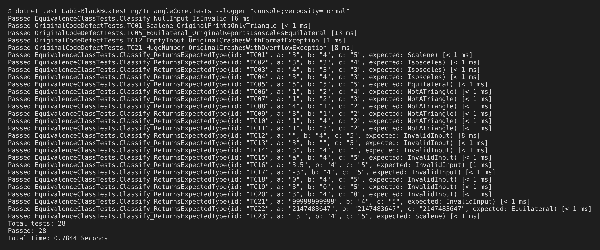

# 实验二　黑盒测试　实验报告

| 课程名称 | 软件质量保证与测试（1960673） | 实验名称 | 黑盒测试（等价类划分法） |
|---|---|---|---|
| 学　　号 | ________ | 姓　　名 | ________ |
| 专业班级 | 软件工程 ____ 班 | 实验地点 | 华信软件学院 B514 机房 |
| 实验日期 | 2026.11.23（第13周）、2026.11.30（第14周） | 指导教师 | ________ |
| 成　　绩 | | | |

## 一、实验说明

### 1. 实验目的
1. 熟悉黑盒测试的基本概念：不考虑程序内部结构，只依据需求规格检查输入与输出；
2. 熟练掌握等价类划分法，能够划分有效/无效等价类并设计测试用例；
3. 学会使用 AutoRunner 进行 GUI 录制与回放的自动化测试。

### 2. 实验内容
对实验一的“三角形形状判定”程序（读入 3 个正整数，判断普通/等腰/等边三角形）进行黑盒测试：
1. 用等价类方法设计测试用例；
2. 用 AutoRunner 执行自动化测试，输出测试脚本和测试结果。

### 3. 实验环境
Windows 10/11，泽众 AutoRunner，被测程序 `TriangleApp.exe`（实验一），xUnit（.NET 8）。

### 4. 实验步骤
1. 根据等价类划分原则划分等价类；
2. 根据等价类设计测试用例；
3. 安装 AutoRunner；
4. 运行被测程序，用 AutoRunner 录制“输入三边 → 点击 check”的操作，生成测试脚本；
5. 回放脚本执行自动化测试，记录测试结果。

## 二、实验分析

### 1. 等价类划分的依据
等价类划分法把所有可能的输入划分为若干个子集，同一子集中的数据对发现缺陷的作用相同，每个子集选一个代表即可。划分原则：
- **有效等价类**：符合规格的合理输入，设计用例时**一个用例尽可能多地覆盖有效等价类**；
- **无效等价类**：不符合规格的输入，设计用例时**一个用例只覆盖一个无效等价类**，避免多个错误互相掩盖。

本题的输入条件可以从五个方面分析：
1. **完整性**：三个文本框是否都有输入；
2. **类型**：是否为整数（字母、小数都不是）；
3. **取值范围**：是否为正整数，是否在 int 可表示的范围内；
4. **能否构成三角形**：任意两边之和必须大于第三边，“小于”和“等于”是两种不同的违反情况，三条边各需要考虑一次；
5. **输出类型**：等边、等腰（三种相等组合）、普通，需求中要区分的输出也作为划分依据。

### 2. 等价类表

| 输入条件 | 有效等价类 | 编号 | 无效等价类 | 编号 |
|---|---|---|---|---|
| 输入完整性 | 三边均有输入 | ① | A 为空 | ⑩ |
| | | | B 为空 | ⑪ |
| | | | C 为空 | ⑫ |
| 输入类型 | 三边均为整数 | ② | 含非数字字符 | ⑬ |
| | | | 含小数 | ⑭ |
| 取值范围 | 1 ≤ 边长 ≤ 2147483647 | ③ | 负数 | ⑮ |
| | | | A = 0 | ⑯ |
| | | | B = 0 | ⑰ |
| | | | C = 0 | ⑱ |
| | | | 超出 int 范围 | ⑲ |
| 构成三角形 | A+B>C 且 B+C>A 且 A+C>B | ④ | A+B<C | ⑳ |
| | | | A+B=C | ㉑ |
| | | | B+C<A | ㉒ |
| | | | B+C=A | ㉓ |
| | | | A+C<B | ㉔ |
| | | | A+C=B | ㉕ |
| 等边 | A=B=C | ⑤ | | |
| 等腰 | A=B≠C | ⑥ | | |
| | B=C≠A | ⑦ | | |
| | A=C≠B | ⑧ | | |
| 普通 | A≠B 且 B≠C 且 A≠C | ⑨ | | |

## 三、测试用例

| 用例编号 | A | B | C | 覆盖等价类 | 期望输出 |
|---|---|---|---|---|---|
| TC01 | 3 | 4 | 5 | ①②③④⑨ | 普通三角形 |
| TC02 | 3 | 3 | 4 | ①②③④⑥ | 等腰三角形 |
| TC03 | 4 | 3 | 3 | ①②③④⑦ | 等腰三角形 |
| TC04 | 3 | 4 | 3 | ①②③④⑧ | 等腰三角形 |
| TC05 | 5 | 5 | 5 | ①②③④⑤ | 等边三角形 |
| TC06 | 1 | 2 | 4 | ⑳ | 不能构成三角形！ |
| TC07 | 1 | 2 | 3 | ㉑ | 不能构成三角形！ |
| TC08 | 4 | 1 | 2 | ㉒ | 不能构成三角形！ |
| TC09 | 3 | 1 | 2 | ㉓ | 不能构成三角形！ |
| TC10 | 1 | 4 | 2 | ㉔ | 不能构成三角形！ |
| TC11 | 1 | 3 | 2 | ㉕ | 不能构成三角形！ |
| TC12 | （空） | 4 | 5 | ⑩ | 输入不合法 |
| TC13 | 3 | （空） | 5 | ⑪ | 输入不合法 |
| TC14 | 3 | 4 | （空） | ⑫ | 输入不合法 |
| TC15 | a | 4 | 5 | ⑬ | 输入不合法 |
| TC16 | 3.5 | 4 | 5 | ⑭ | 输入不合法 |
| TC17 | -3 | 4 | 5 | ⑮ | 输入不合法 |
| TC18 | 0 | 4 | 5 | ⑯ | 输入不合法 |
| TC19 | 3 | 0 | 5 | ⑰ | 输入不合法 |
| TC20 | 3 | 4 | 0 | ⑱ | 输入不合法 |
| TC21 | 99999999999 | 4 | 5 | ⑲ | 输入不合法 |
| TC22 | 2147483647 | 2147483647 | 2147483647 | ③ 上边界 | 等边三角形 |
| TC23 | “ 3 ”（含空格） | 4 | 5 | 补充：首尾空白 | 普通三角形 |

25 个等价类全部被覆盖：有效类 ①~⑨ 由 TC01~TC05 覆盖，无效类 ⑩~㉕ 每个由一个用例单独覆盖。TC22、TC23 是从边界和容错角度补充的用例。

## 四、程序运行结果

### 1. AutoRunner 录制与回放
按指导书附件步骤操作：
1. 文件 → 新建 → 项目，项目名 `Test`；
2. 文件 → 新建 → 脚本；
3. 运行 `TriangleApp.exe`；
4. 点击“开始录制”，依次在边 A/B/C 输入 3、4、5，点击 check，关闭结果弹窗，结束录制，生成脚本；
5. 将录制得到的语句放入数据驱动脚本 `AutoRunner/TriangleTest.js` 的 `runCase()` 中，遍历 TC01~TC23；
6. 点击工具栏“执行脚本”回放，在输出窗口查看结果。

测试脚本（数据驱动部分）：

```javascript
var cases = [
    ["TC01", "3", "4", "5", "普通三角形"],
    ["TC02", "3", "3", "4", "等腰三角形"],
    // …… TC03 ~ TC23 同上表
];
function runCase(a, b, c) {
    // ===== AutoRunner 录制生成的语句 =====
    // sideATextBox.SetText(a); sideBTextBox.SetText(b); sideCTextBox.SetText(c);
    // checkButton.Click(); var actual = resultLabel.GetText();
    // 判定结果对话框.确定.Click();
    return actual;
}
for (var k = 0; k < cases.length; k++) { /* 比较 actual 与期望值并输出 PASS/FAIL */ }
```

> 【截图 1：AutoRunner 新建项目 Test 与脚本】
> 【截图 2：录制过程——在被测程序中输入 3、4、5 并点击 check】
> 【截图 3：录制生成的测试脚本】
> 【截图 4：回放执行后输出窗口显示“执行成功”及各用例 PASS】

### 2. xUnit 自动化测试结果
为了在逻辑层面重复执行全部用例，还把上表写成了 xUnit 数据驱动测试（`TriangleCore.Tests/EquivalenceClassTests.cs`），每个用例对应一个 `[InlineData]`：

```csharp
[InlineData("TC01", "3", "4", "5", TriangleType.Scalene)]
[InlineData("TC12", "",  "4", "5", TriangleType.InvalidInput)]
[InlineData("TC21", "99999999999", "4", "5", TriangleType.InvalidInput)]
...
public void Classify_ReturnsExpectedType(string id, string a, string b, string c, TriangleType expected)
```

执行结果（28 个测试全部通过）：



### 3. 原代码缺陷验证
把指导书附件中的原始判定逻辑原样摘录到 `OriginalCodeDefectTests.cs`，用相同的用例测试，结果如下（这些测试断言的是“原代码的错误行为确实发生”）：

| 用例 | 输入 | 期望输出 | 原代码实际表现 | 结论 |
|---|---|---|---|---|
| TC12 | （空）, 4, 5 | 输入不合法 | 抛出 `FormatException`，程序崩溃 | 缺陷 |
| TC21 | 99999999999, 4, 5 | 输入不合法 | 抛出 `OverflowException`，程序崩溃 | 缺陷 |
| TC05 | 5, 5, 5 | 等边三角形 | 输出“等腰等边三角形” | 缺陷 |
| TC01 | 3, 4, 5 | 普通三角形 | 输出“三角形” | 与需求不符 |

### 4. 测试结果汇总

| 项目 | 数量 |
|---|---|
| 设计的等价类 | 25（有效 9，无效 16），另有 2 个补充用例 |
| 测试用例 | 23（+1 个 null 输入） |
| 改进后程序通过 | 24 / 24 |
| 原代码发现缺陷 | 4 处 |

## 五、实验体会

1. **等价类法让用例“少而全”。** 三条边的输入组合无穷多，但划分出 25 个等价类后，只用 23 个用例就把每一类都覆盖到了。用例数量可控，同时能说明“哪些情况已测过”。
2. **无效等价类必须一个一个测。** 如果一个用例里同时放“空输入”和“非数字”，程序只要报“输入不合法”就算通过，却无法知道每种错误是否都被正确处理。坚持“一个用例只覆盖一个无效类”后，TC12（空输入）单独暴露了原代码的崩溃问题。
3. **“等于”与“小于”要分开。** A+B=C 是最容易写错的边界（把 `>` 写成 `>=`），因此把 A+B<C 和 A+B=C 划分成不同的无效类，三条边各测一次，共 6 个用例。
4. **黑盒测试能发现真实缺陷。** 不看源代码，只按需求设计的用例就找出了原程序的 4 处问题，其中两处会直接导致程序崩溃，说明黑盒测试是验证需求最直接的手段。
5. **自动化测试便于回归。** 用例写成脚本后，每次修改代码都能在几秒内重新执行全部用例。AutoRunner 从用户界面层回放操作，xUnit 从逻辑层直接调用，二者配合，既覆盖了界面交互也覆盖了核心逻辑。
