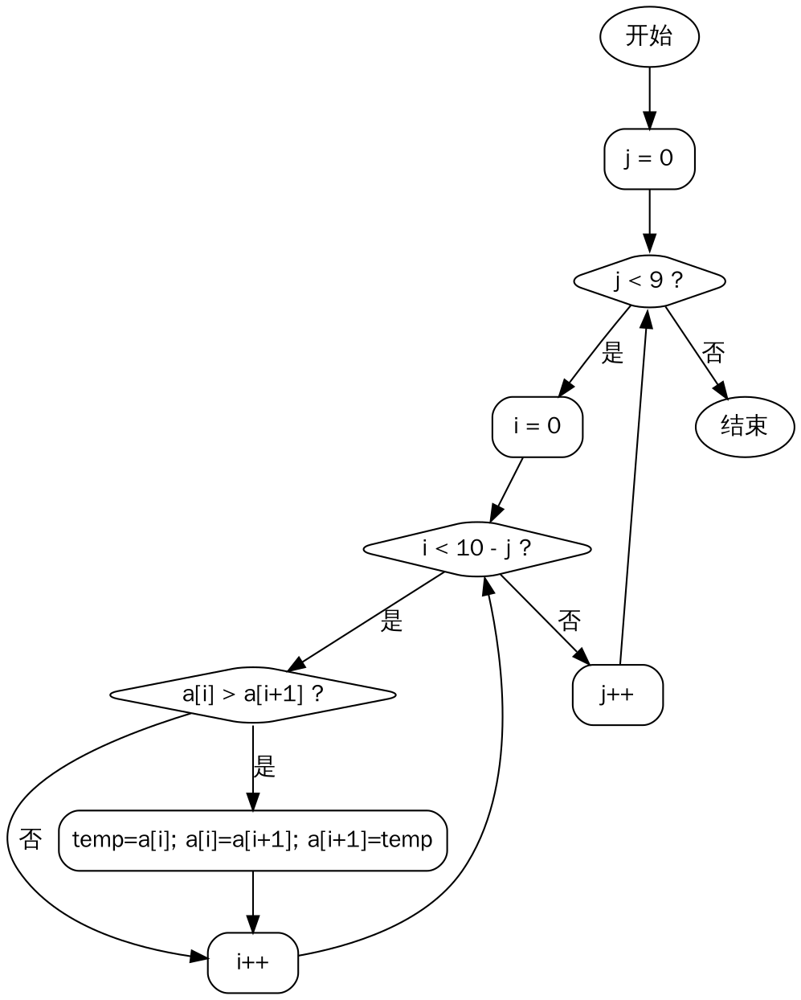
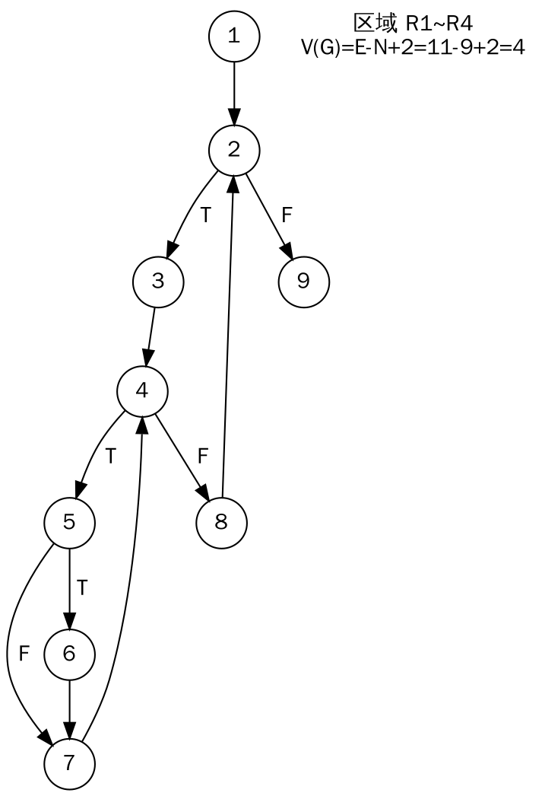
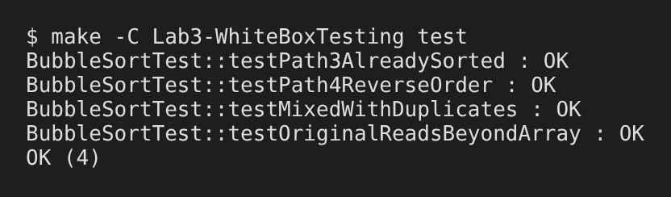

# 实验三　白盒测试　实验报告

| 课程名称 | 软件质量保证与测试（1960673） | 实验名称 | 白盒测试（基本路径法） |
|---|---|---|---|
| 学　　号 | ________ | 姓　　名 | ________ |
| 专业班级 | 软件工程 ____ 班 | 实验地点 | 华信软件学院 B514 机房 |
| 实验日期 | 2026.12.7（第15周）、2026.12.14（第16周） | 指导教师 | ________ |
| 成　　绩 | | | |

## 一、实验说明

### 1. 实验目的
1. 理解白盒测试的概念：依据程序内部逻辑结构设计测试用例；
2. 理解为什么要在开发过程中进行白盒测试；
3. 熟练掌握基本路径测试法：画控制流图、计算环路复杂度、导出独立路径、设计用例；
4. 掌握 CppUnit 单元测试框架的配置与使用。

### 2. 实验内容
用基本路径法对下面的冒泡排序算法进行白盒测试，数组 a 的长度为 10：

```c
void BubbleSort(int a[])
{
    int i, j, temp;
    for (j = 0; j < 9; j++)
    {
        for (i = 0; i < 10 - j; i++)
        if (a[i] > a[i + 1])
        {
            temp = a[i];
            a[i] = a[i + 1];
            a[i + 1] = temp;
        }
    }
}
```

要求：
1. 绘制程序流程图、流图，给出测试路径；
2. 编写测试用例；
3. 用 CppUnit 选择测试用例进行测试，并给出测试结果。

### 3. 实验环境
Windows 10/11 + Visual Studio 2022 + CppUnit 1.15（Linux 下用 g++ + libcppunit-dev 同样可以编译运行）。

### 4. 实验步骤
1. 绘制程序流程图和控制流图；
2. 计算环路复杂度，给出独立路径；
3. 根据独立路径设计测试用例（输入、期望输出）；
4. 在 VS 中配置 CppUnit，编译生成 `cppunit.lib`；
5. 建立工程 `bsort` 实现冒泡排序；
6. 建立测试项目 `testBubbleSort` 编写测试程序（共 5 个文件）；
7. 运行测试项目，展示测试结果。

## 二、实验分析

### 1. 程序流程图



### 2. 控制流图（流图）
给源程序语句标号，把顺序执行的语句合并为一个节点：

| 节点 | 对应语句 |
|---|---|
| 1 | `j = 0` |
| 2 | 判定 `j < 9` |
| 3 | `i = 0` |
| 4 | 判定 `i < 10 - j` |
| 5 | 判定 `a[i] > a[i + 1]` |
| 6 | 交换 `temp = a[i]; a[i] = a[i+1]; a[i+1] = temp;` |
| 7 | `i++` |
| 8 | `j++` |
| 9 | 函数结束 |



### 3. 环路复杂度
用三种方法计算，结果一致：
- V(G) = E − N + 2 = 11 − 9 + 2 = **4**（边 E=11：1-2, 2-3, 2-9, 3-4, 4-5, 4-8, 5-6, 5-7, 6-7, 7-4, 8-2；节点 N=9）
- V(G) = P + 1 = 3 + 1 = **4**（判定节点 P=3：节点 2、4、5）
- V(G) = 区域数 = **4**（三个封闭区域 + 一个外部区域）

因此至少需要 4 条独立路径。

### 4. 独立路径

| 路径 | 节点序列 | 含义 |
|---|---|---|
| Path1 | 1 → 2 → 9 | 外层循环一次都不执行 |
| Path2 | 1 → 2 → 3 → 4 → 8 → 2 → … → 9 | 内层循环一次都不执行 |
| Path3 | 1 → 2 → 3 → 4 → 5 → 7 → 4 → … → 8 → 2 → … → 9 | 内层循环执行，比较结果为假（不交换） |
| Path4 | 1 → 2 → 3 → 4 → 5 → 6 → 7 → 4 → … → 8 → 2 → … → 9 | 内层循环执行，比较结果为真（交换） |

每条路径都至少包含一条其他路径没有的新边：Path1 有 2→9，Path2 有 4→8、8→2，Path3 有 5→7，Path4 有 5→6、6→7。

### 5. 路径可行性分析
- **Path1 不可达**：j 的初值为 0，第一次判定 `0 < 9` 必为真，外层循环不可能一次都不执行；
- **Path2 不可达**：j 最大为 8，此时内层条件 `i < 10 - 8 = 2`，i=0 时必为真，内层循环每轮至少执行一次。

这两条路径在数组长度固定为 10 时无法单独执行，但它们引入的边 2→9 和 4→8、8→2 在每次循环退出时都会经过，因此执行 Path3、Path4 的用例时这些边也被覆盖了。可执行路径为 Path3 和 Path4。

### 6. 白盒测试发现的缺陷：数组越界
分析节点 4、5 时发现：当 j = 0 时，内层条件为 `i < 10`，i 最大取 9，此时节点 5 执行 `a[9] > a[10]`，而数组下标只有 0~9，**访问了 a[10]，数组越界**。
- 这是未定义行为：可能读到相邻内存中的垃圾值并交换进数组，同时把数组中最大的元素写到数组外，破坏其他变量；
- 普通输入下排序结果有时“碰巧”正确，所以只看输出的黑盒测试很难发现，必须结合代码结构分析。

**修正**：把内层循环条件改为 `i < 9 - j`（代码中写作 `ARRAY_SIZE - 1 - j`）。修正后控制流图结构不变，上述路径与用例仍然适用。

## 三、测试用例

| 用例 | 覆盖路径 | 输入 a[0..9] | 期望输出 |
|---|---|---|---|
| TC1 | Path3（比较恒为假，不交换） | {0, 1, 2, 3, 4, 5, 6, 7, 8, 9} | {0, 1, 2, 3, 4, 5, 6, 7, 8, 9} |
| TC2 | Path4（每次比较为真，交换） | {9, 8, 7, 6, 5, 4, 3, 2, 1, 0} | {0, 1, 2, 3, 4, 5, 6, 7, 8, 9} |
| TC3 | Path3 + Path4 混合 | {5, -3, 8, 5, 0, 12, -3, 7, 1, 5} | {-3, -3, 0, 1, 5, 5, 5, 7, 8, 12} |
| TC4 | 越界缺陷验证 | 长度 11 的缓冲区 {9, 8, …, 0, -1}，第 11 个元素 -1 为“哨兵” | 原算法：哨兵 -1 被排进数组、9 被写到数组外；修正后算法：哨兵保持 -1 不变 |

## 四、程序运行结果

### 1. 工程结构（5 个文件）

| 工程 | 文件 | 作用 |
|---|---|---|
| bsort | `BubbleSort.h` | 声明修正后的 `BubbleSort` 和原版 `BubbleSortOriginal` |
| bsort | `BubbleSort.cpp` | 冒泡排序实现 |
| testBubbleSort | `BubbleSortTest.h` | 测试类声明，用 `CPPUNIT_TEST_SUITE` 注册 4 个测试方法 |
| testBubbleSort | `BubbleSortTest.cpp` | 测试用例实现 |
| testBubbleSort | `main.cpp` | 测试入口，逐条输出测试结果 |

VS 配置：项目属性 → C/C++ → 附加包含目录添加 `cppunit\include`；链接器 → 附加库目录添加 `cppunit\lib`，附加依赖项添加 `cppunitd.lib`（Debug）或 `cppunit.lib`（Release）。

### 2. 被测代码（修正后）

```cpp
void BubbleSort(int a[])
{
    int i, j, temp;
    for (j = 0; j < ARRAY_SIZE - 1; j++)
    {
        for (i = 0; i < ARRAY_SIZE - 1 - j; i++)   // 原为 i < 10 - j，越界
        {
            if (a[i] > a[i + 1])
            {
                temp = a[i];
                a[i] = a[i + 1];
                a[i + 1] = temp;
            }
        }
    }
}
```

### 3. 测试代码（节选）

```cpp
class BubbleSortTest : public CppUnit::TestFixture
{
    CPPUNIT_TEST_SUITE(BubbleSortTest);
    CPPUNIT_TEST(testPath3AlreadySorted);
    CPPUNIT_TEST(testPath4ReverseOrder);
    CPPUNIT_TEST(testMixedWithDuplicates);
    CPPUNIT_TEST(testOriginalReadsBeyondArray);
    CPPUNIT_TEST_SUITE_END();
    ...
};

void BubbleSortTest::testPath4ReverseOrder()
{
    int input[ARRAY_SIZE]    = {9, 8, 7, 6, 5, 4, 3, 2, 1, 0};
    int expected[ARRAY_SIZE] = {0, 1, 2, 3, 4, 5, 6, 7, 8, 9};
    BubbleSort(input);
    assertArrayEquals(expected, input, ARRAY_SIZE);   // 逐个元素 CPPUNIT_ASSERT_EQUAL
}

void BubbleSortTest::testOriginalReadsBeyondArray()
{
    int buffer[ARRAY_SIZE + 1] = {9, 8, 7, 6, 5, 4, 3, 2, 1, 0, -1};
    BubbleSortOriginal(buffer);
    // 断言：-1 出现在前 10 个元素中，且 buffer[10] 被改成了 9
    ...
}
```

完整代码见 `bsort/` 与 `testBubbleSort/`。

### 4. 测试结果



| 用例 | 测试方法 | 结果 |
|---|---|---|
| TC1 | testPath3AlreadySorted | OK |
| TC2 | testPath4ReverseOrder | OK |
| TC3 | testMixedWithDuplicates | OK |
| TC4 | testOriginalReadsBeyondArray | OK（证实原算法越界，修正版不越界） |

> 【截图：在 VS 中运行 testBubbleSort 的控制台输出】（若老师要求 VS 环境截图，粘贴于此）

## 五、实验体会

1. **基本路径法给出了“最少要测多少”。** 计算出环路复杂度为 4 后，就知道至少需要 4 条独立路径，设计用例有了明确的依据，不会遗漏分支，也不会盲目堆砌用例。
2. **白盒测试能发现黑盒测试发现不了的缺陷。** 本次在画流图、分析内层循环边界时发现了 `i < 10 - j` 导致访问 a[10] 的越界错误。用 TC2 这样的普通输入运行原代码，输出有时完全正确，只看输入输出很难察觉；而通过“哨兵”元素（TC4），越界被测试明确地证实了。
3. **并非所有独立路径都可执行。** Path1、Path2 在数组长度固定时不可达。这说明设计用例时不能机械套用路径，还要结合程序语义分析可行性，并说明不可达路径的边是如何被其他用例覆盖的。
4. **单元测试框架让测试可以重复执行。** CppUnit 的断言宏和测试套件把用例固化为代码，修改排序算法后重新编译运行即可得到全部结果，测试失败时还会指出具体出错的数组下标，便于定位问题。
5. **白盒和黑盒互为补充。** 实验二从需求出发验证“做得对不对”，本实验从代码结构出发验证“每条路径都走过、边界都正确”，两种方法结合才能更全面地保证软件质量。
