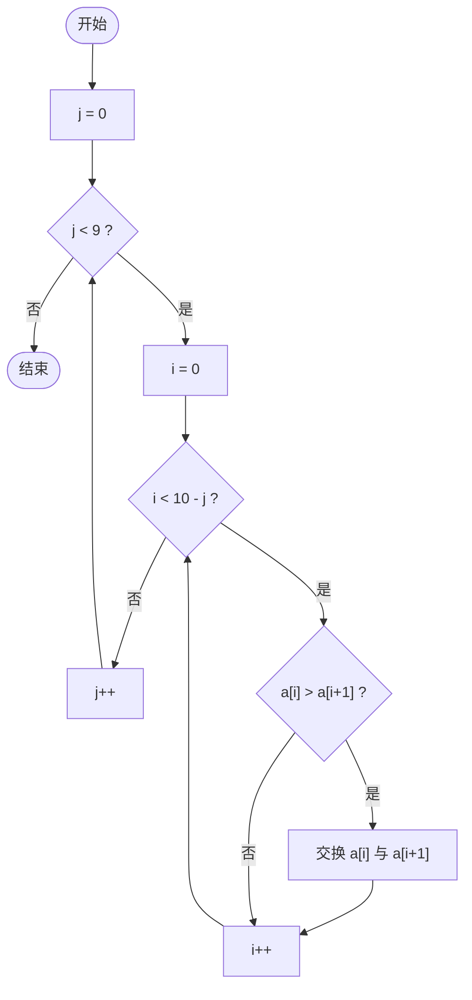
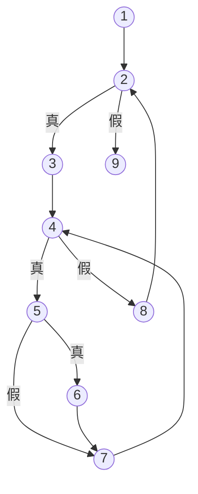

# 实验3 白盒测试 实验报告

## 一、实验目的
理解白盒测试的意义，掌握基本路径测试法，并用 CppUnit 编写、执行单元测试。

## 二、被测代码（指导书原文，标注节点编号）

```c
void BubbleSort(int a[])
{
    int i, j, temp;
    for (j = 0;  /*①*/  j < 9;  /*②*/  j++ /*⑧*/)
    {
        for (i = 0; /*③*/  i < 10 - j; /*④*/  i++ /*⑦*/)
            if (a[i] > a[i + 1])                     /*⑤*/
            {
                temp = a[i]; a[i] = a[i + 1]; a[i + 1] = temp;   /*⑥*/
            }
    }
}                                                    /*⑨*/
```

## 三、程序流程图



## 四、控制流图（流图）



节点 N = 9，边 E = 11，判定节点 P = 3（②④⑤）。

**环路复杂度** V(G) = E − N + 2 = 11 − 9 + 2 = **4** = P + 1 = 区域数 4。

## 五、独立路径

| 路径 | 节点序列 | 说明 |
|---|---|---|
| Path1 | 1-2-9 | 外层循环一次不执行 |
| Path2 | 1-2-3-4-8-2-…-9 | 内层循环一次不执行 |
| Path3 | 1-2-3-4-5-7-4-…-8-2-…-9 | 内层执行，比较为假（不交换） |
| Path4 | 1-2-3-4-5-6-7-4-…-8-2-…-9 | 内层执行，比较为真（交换） |

**可行性分析**：数组长度固定为 10，`j` 初值 0 必满足 `j<9`，故 Path1 不可达；`j` 最大为 8 时 `10-j=2>0`，内层至少执行一次，故 Path2 不可达。二者属于不可行路径，只能被包含在 Path3/Path4 的最后一次判定出口中覆盖（2→9、4→8 两条边在每次循环退出时都会经过）。因此设计用例覆盖 Path3、Path4。

## 六、测试用例

| 用例 | 覆盖路径 | 输入 a[10] | 期望输出 |
|---|---|---|---|
| TC1 | Path3 | {0,1,2,3,4,5,6,7,8,9}（已升序） | {0,1,2,3,4,5,6,7,8,9} |
| TC2 | Path4 | {9,8,7,6,5,4,3,2,1,0}（逆序） | {0,1,2,3,4,5,6,7,8,9} |
| TC3 | Path3+Path4 | {5,-3,8,5,0,12,-3,7,1,5}（含重复、负数） | {-3,-3,0,1,5,5,5,7,8,12} |

## 七、白盒测试发现的缺陷

分析内层循环条件 `i < 10 - j`：当 `j = 0` 时 `i` 取到 9，语句 `a[i] > a[i + 1]` 访问 **a[10]，数组越界**（长度为 10，下标 0~9）。这是未定义行为：可能读到相邻内存的垃圾值并把它交换进数组，同时把数组最大元素写到数组外，破坏其它变量。

修正：内层循环条件改为 `i < 9 - j`（代码中写作 `ARRAY_SIZE - 1 - j`）。修正后控制流图结构不变，上述路径与用例同样适用。

测试 `testOriginalReadsBeyondArray` 用一个长度为 11、末元素为哨兵 `-1` 的缓冲区证实了该缺陷：原算法把 `-1` 排进了前 10 个元素，并把 `9` 写入 `a[10]`；修正后的算法不触碰 `a[10]`。

## 八、CppUnit 测试工程

```
bsort/BubbleSort.h            冒泡排序声明（修正版 BubbleSort + 原版 BubbleSortOriginal）
bsort/BubbleSort.cpp          冒泡排序实现
testBubbleSort/BubbleSortTest.h    测试夹具声明（CPPUNIT_TEST_SUITE）
testBubbleSort/BubbleSortTest.cpp  测试用例实现
testBubbleSort/main.cpp            TextUi::TestRunner 入口
Makefile                      Linux 下构建：make test
```

VS 中使用：按指导书配置好 cppunit 的包含目录与 `cppunit.lib`（Debug 为 `cppunitd.lib`），将上述 5 个文件加入 `testBubbleSort` 工程编译运行即可。

## 九、测试结果

```
$ make -C Lab3-WhiteBoxTesting test
./testBubbleSort/testBubbleSort
....

OK (4)
```

4 个测试全部通过：TC1、TC2、TC3 验证修正后的排序结果正确；越界缺陷测试证实原算法的问题。

## 十、总结
基本路径法从代码结构出发，通过环路复杂度确定最少的独立路径数，并能发现黑盒测试难以察觉的缺陷（如本次的数组越界——对普通输入，原算法甚至可能“碰巧”输出正确结果）。同时，路径可行性分析表明并非所有独立路径都能被执行，需结合程序语义设计用例。
